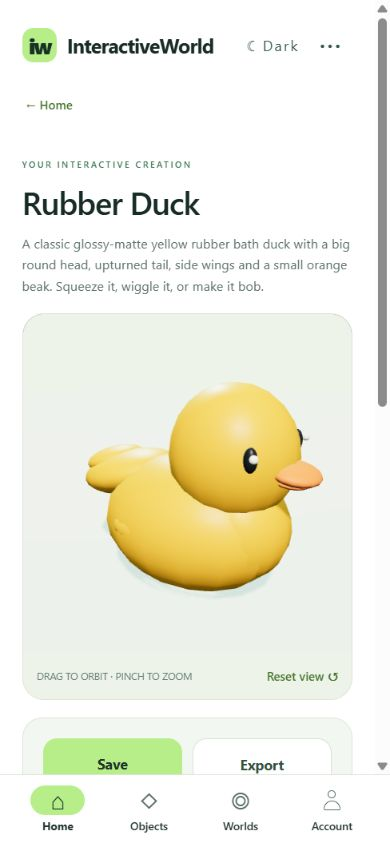
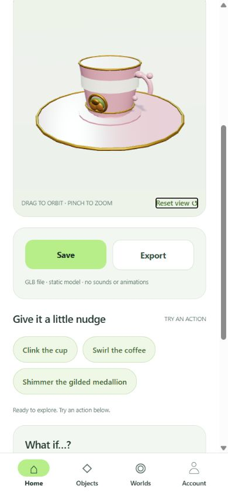
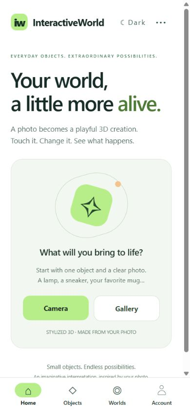
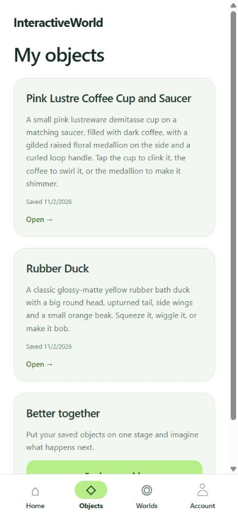
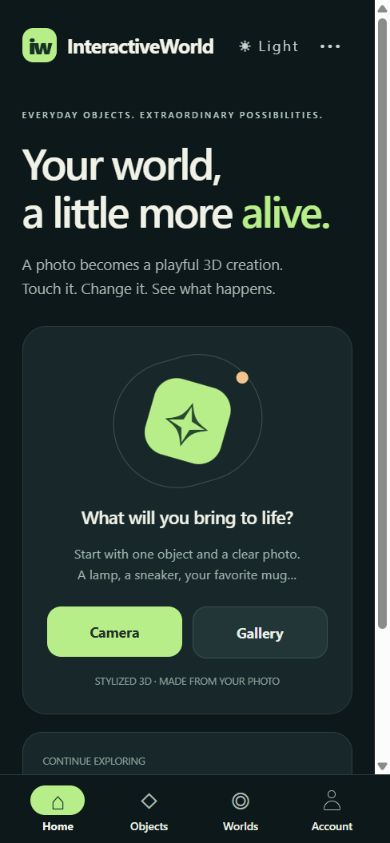
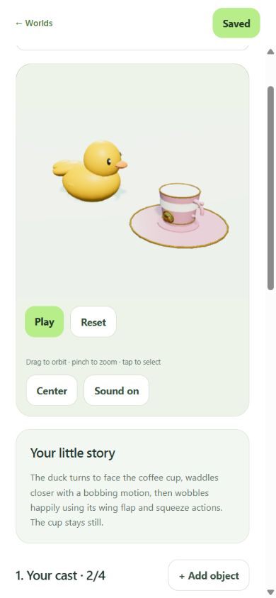

<p align="center">
  
</p>

<p align="center">
  <strong>Scan the ordinary. Create something extraordinary.</strong><br/>
  Turn everyday objects into interactive 3D creations—and bring them together in a world of your own.
</p>

<p align="center">
  
  
  
  
</p>

<p align="center">
  <a href="#from-a-photo-to-something-you-can-play-with">See the app</a> ·
  <a href="#bring-them-together">Explore Worlds</a> ·
  <a href="#run-it-locally">Get started</a> ·
  <a href="#under-the-surface">How it works</a>
</p>

# InteractiveWorld

Your mug, a rubber duck, a desk lamp: photograph something around you and explore a procedural 3D interpretation of it. Rotate the model, tap its parts, try its actions, ask for a change, or export it as a GLB file. Save your favorites to your account, then put them on the same stage and describe what happens next.

**Capture → explore → save → bring together.**

## From a photo to something you can play with

Two photo-generated objects, shown in the app's current interface:

| A little personality | A little coffee break |
| :---: | :---: |
|  |  |
| A rubber duck becomes a model with its own playful actions. | A cup and saucer keep their distinctive colors, shape, and decorative details. |

These are actual browser screenshots of generated scenes at a phone-sized viewport. Models are procedural interpretations of photographs, rather than exact 3D scans or photogrammetry meshes.

### Familiar navigation. Room to create.

| Start with a photo | Keep your creations |
| :---: | :---: |
|  |  |

- **Home** puts Camera and Gallery within easy reach. Add an optional hint, confirm the preview, and tap **Bring it to life**.
- **Objects** holds your saved models. Tap a card to reopen the model and its actions without another AI request.
- **Worlds** brings objects from your saved collection onto one shared stage.
- **Account** keeps profile and account actions together. The app requires sign-in before scanning.

The white and dark palettes share the same layout. Theme preference is remembered on the device. Back links use compact labels such as **← Home**; model controls group **Save** and **Export** together. The world editor keeps Back and Save visible while you scroll and checks for unsaved changes before leaving.

<details>
<summary><strong>After dark</strong> — the same experience in a quieter palette</summary>
<br/>
<p align="center"></p>
</details>

## Bring them together

**Your saved objects. One shared stage. A story you direct.**

> “Make the duck turn toward the coffee cup, waddle closer, then wobble happily. Keep the cup still.”

<p align="center">
  
</p>

*The same saved duck and cup, arranged in the current Worlds editor. The example interaction was generated through the real World planning flow. The screenshot shows a still view of the scene.*

1. Open **Worlds → + New world** and choose up to four objects from your own saved collection.
2. Tap an object or its name to select it. Move, turn, and resize it with the arrangement controls.
3. Describe the interaction and tap **Animate**. Use **Play** to watch it and **Reset** to return to the starting arrangement.
4. Tap **Save** to keep the world in your account. Reopen it later to play, rearrange, or create another interaction.

Worlds reuse each object's saved geometry and available actions. The AI plans movement, turns, and existing behaviors; it does not redraw the objects. Playback and reopening a saved world run locally without an AI request. Changing the layout clears the previous interaction so it cannot play against outdated positions.

Interactions are short, stylized animations: up to 20 seconds and 16 steps. They do not include collision physics, fluid simulation, or new articulation beyond the objects' existing actions. A world supports four object instances and up to 240 mesh parts in total; the same saved object can appear more than once.

## Made for exploring

| Feature | What it brings to the experience |
| --- | --- |
| Camera and gallery | Preview and confirm a resized photo; clarify which object you mean |
| Interactive 3D | Orbit, zoom, reset the view, and tap generated actions |
| Reimagine | Describe a change under **What if…?** and update the current model |
| Contextual sounds | 21 short local effects, selected when an interaction suits them; mute in the viewer |
| Saved objects | Account-owned snapshots with scene code, descriptions, actions, and sound choices |
| Saved worlds | Keep an arrangement and its interaction together for later playback |
| GLB export | Save or share a portable, static model with geometry and materials |
| Stop and retry | Cancel generation, recover from errors, or choose another photo |
| Two themes | White by default, with an optional dark palette |

### Small details that matter

A failed replacement keeps the last working model safe. Unrecognized photos show guidance and photo-selection options. **Stop** cancels the in-flight request, and requests reaching two minutes stop with a retryable error. Photo analysis permits ten attempts in a rolling three-minute window, with a visible countdown when the limit is reached; enforcement currently lives in backend memory and resets when the backend restarts.

Sounds are synthesized locally, with no downloads or extra AI calls. They are short stylized effects, rather than recordings of the photographed object. Browsers may require a tap inside the viewer before audio can play.

**Export** opens the system sharing/save dialog on mobile or a download in the browser. The `.glb` includes the last successfully loaded object's resting geometry and materials. Interactive animations, sounds, studio lighting, and the floor are excluded. Export runs locally; the file size limit is 9 MiB.

## Run it locally

You need **Node.js 24**, npm, and Android Expo Go compatible with **Expo SDK 58**. For phone testing, connect the phone and computer to the same trusted Wi-Fi network.

```powershell
npm ci
Copy-Item .env.example .env
```

Fill in `CLAUDE_API` in `.env`. Keep it on the backend; never prefix the key with `EXPO_PUBLIC_` or commit it.

Start the backend:

```powershell
npm run server
```

In a second terminal, start Expo:

```powershell
npm start
```

Scan the QR code in Expo Go. The app detects the Metro host and connects to port `3001`. Use the top-right **•••** connection settings to adjust the backend address, then tap **Test connection**. Create an account or sign in to reach Home.

For browser development, use `npm run web`. Expo's tunnel option can help with the Expo connection (`npm start -- --tunnel`), but it does **not** tunnel the separate backend: the phone must still reach its configured backend URL.

If the phone cannot connect, open `http://YOUR_COMPUTER_WIFI_IP:3001/health` in its browser. Check the address, private-network firewall permission, and Wi-Fi client isolation. A standalone mobile build should use an HTTPS backend.

### Your data

Drizzle ORM uses Node 24's built-in SQLite driver. Migrations run automatically, and the default database is `.local/interactiveworld.db`; override it with `DATABASE_PATH`. Database files, local artifacts, and secrets are ignored by Git. Back up the database before schema changes or moving the backend.

- Accounts use salted scrypt password hashes and revocable sessions that expire after 30 days.
- Native session tokens use Expo SecureStore; the browser uses sessionStorage.
- Saved objects belong to their account and exclude the original photo and current animation pose. Identical saves are deduplicated; edited models can be saved separately.
- Saved worlds store the arrangement, interaction, and references to owned objects. Ownership is checked by the backend.
- Signing out revokes the session. Account deletion requires password confirmation and removes the account's saved objects and worlds.

The current unsaved model remains available during the session through **← Home** and its **Open →** shortcut. Restarting the app clears that unsaved scene. Save models and worlds you want to keep; they are stored in the backend database. Email verification and email-based password recovery are not configured.

SQLite suits this single-backend prototype. Scaling to multiple instances requires a shared database such as PostgreSQL, shared rate-limit storage, and an HTTPS deployment. Stable UUIDs and owner-linked tables give future features a consistent foundation; a PostgreSQL migration still requires a driver/schema migration and data transfer.

## Under the surface

```mermaid
flowchart LR
    A[Photo] --> B[Resize and confirm]
    B --> C[Authenticated backend]
    C --> D[AI scene generation]
    D --> E[Validated scene]
    E --> F[Restricted interpreter]
    F --> G[Three.js viewer]
    G --> H[Saved objects]
    H --> I[World arrangement]
    I --> J[Validated interaction plan]
    J --> G
    style A fill:#edf7e3,stroke:#90b971,color:#22372b
    style G fill:#b7ee8a,stroke:#709d4e,color:#22372b
    style I fill:#edf7e3,stroke:#90b971,color:#22372b
```



| Layer | Responsibility |
| --- | --- |
| `App.tsx`, `mobile/` | Capture, bottom navigation, account UI, saved libraries, and the viewer bridge |
| `server/` | Authentication, ownership, Drizzle persistence, request validation, and AI transport |
| `shared/` | Scene and World schemas, the bounded geometry toolkit, and the local sound catalog |
| `viewer/` | Three.js rendering, restricted ES5 interpretation, actions, World playback, and GLB export |
| `tests/` | Accounts, ownership, generation contracts, cancellation, exports, sounds, and viewer regressions |

Generated source receives a bounded material/part/action toolkit inside a restricted interpreter. It cannot access host APIs, import modules, or fetch external resources. The viewer bundles its dependencies, restricts navigation and file access, and blocks network resources with CSP. Web preview additionally uses a sandboxed iframe. Static geometry can be batched without removing triangles; independently animated transforms stay separate.

The backend is intended for local development on a trusted network. Production hosting needs HTTPS, operational monitoring, and durable shared storage and quotas. Resource limits reduce hangs, but a lost graphics context or stopped WebView can still require **Reload**.

## Develop and verify

```text
npm run typecheck
npm test
npm run viewer:build
npx expo export --platform android --platform web
node --env-file=.env scripts/check-secrets.mjs
```

Rebuild the viewer after editing `viewer/`; its generated HTML is checked in so a clean checkout can run directly. Automated tests use fake transports and do not need API credentials. Browser screenshots and checks complement Android device testing.

For the isolated renderer recovery check, run `npm run viewer:build`, then `node scripts/viewer-qa.mjs` and open `http://localhost:3002`.

### Android APK

`eas.json` includes a `preview` profile for an internal-distribution APK:

```text
npx eas-cli login
npx eas-cli build:configure
npx eas-cli build --platform android --profile preview
```

Link your Expo account when prompted and download the APK from the completed EAS build. The repository does not include a prebuilt APK.

## Screenshot sources

Screenshots show the real app UI using an isolated local showcase account. The cup example used the app's repair path to correct a duplicate part identifier before capture. The object examples were generated from these public test photographs:

- Rubber duck: [Yellow Rubber Duck.jpg](https://commons.wikimedia.org/wiki/File:Yellow_Rubber_Duck.jpg), RandomPerson238, [CC BY-SA 4.0](https://creativecommons.org/licenses/by-sa/4.0/).
- Coffee cup: [Coffee cup - beskaaret 2.JPG](https://commons.wikimedia.org/wiki/File:Coffee_cup_-_beskaaret_2.JPG), Øyvind Holmstad, CC0.

Photographs were resized for testing and remain outside the tracked screenshot assets. The screenshots display generated procedural geometry. Account and World data used for the showcase are separate from the normal application database.
