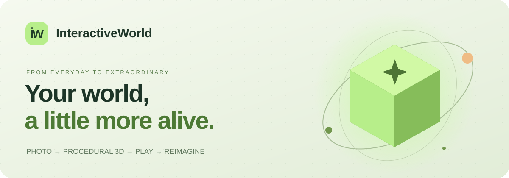
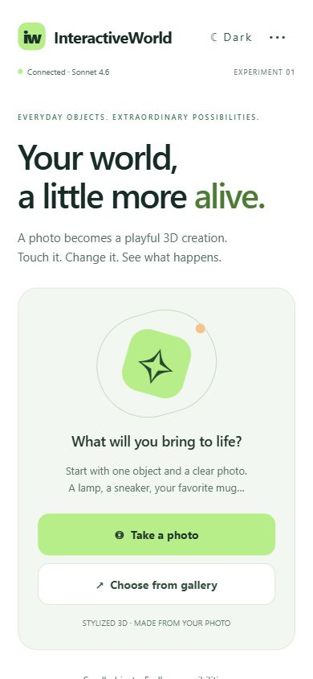
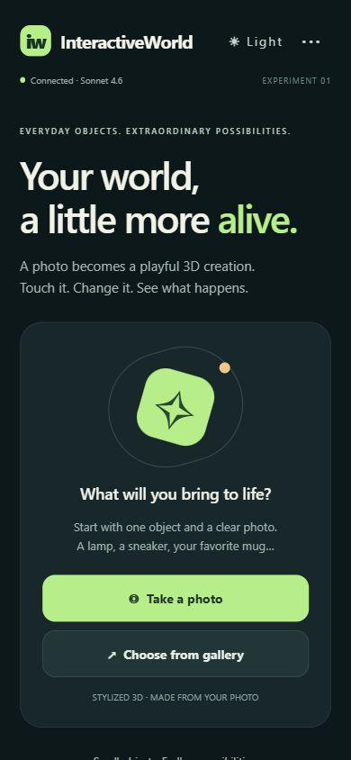
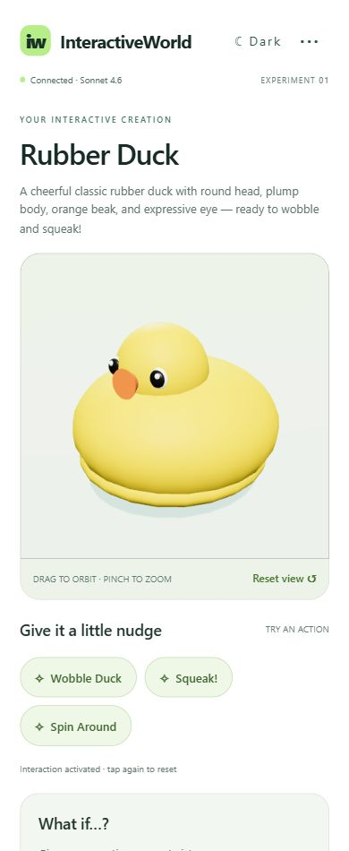
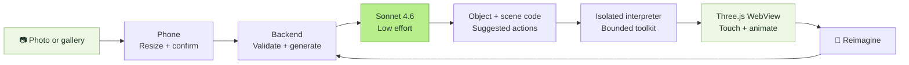

<p align="center"></p>

<p align="center">
  <strong>A camera. A little imagination. A world you can touch.</strong><br/>
  Expo 58 · React Native · Three.js · Claude Sonnet 4.6
</p>

<p align="center">
  <a href="#run-on-your-android-phone">Quick start</a> ·
  <a href="#a-photo-becomes-a-playground">Preview</a> ·
  <a href="#how-it-works">Architecture</a> ·
  <a href="TEST_RESULTS.md">Test results</a> ·
  <a href="IMPLEMENTATION_PLAN.md">Build checkpoints</a>
</p>

# InteractiveWorld

Turn a photo into a stylized procedural 3D object, interact with its parts, and change it through chat. The app uses Expo SDK 58 / React Native, locally bundled Three.js inside a WebView, and a Node backend calling Claude Sonnet 4.6 at low effort.

## A photo becomes a playground

| Fresh by default | A quieter dark mode |
| :---: | :---: |
|  |  |

*Actual browser screenshots at a phone-sized viewport. Physical Android verification is a separate checklist.*

<p align="center"></p>

*A real Sonnet-generated scene from the final integration test. No mock response was used in this preview.*

**Capture → create → interact → reimagine.** Photograph a desk lamp, a favorite mug, or a toy. InteractiveWorld identifies it and writes a new procedural scene while the app is running. Tap a part, try a suggested action, or ask for a change. There is no fixed catalog of object models.

| Feature | What you can do |
| --- | --- |
| Camera + gallery | Confirm a resized photo and clarify the intended object |
| Generated 3D | Explore a stylized object with studio lighting and shadows |
| Playful actions | Tap parts and trigger generated animation and color changes |
| Object sounds | 21 contextual sound effects selected by Claude; mute from the viewer |
| GLB export | Save or share the current object as a portable static 3D model |
| Chat edits | Change the current creation without rebuilding or restarting |
| White + dark themes | Switch with one tap; your choice is remembered locally |
| Recovery | Keep the last working scene when a replacement fails |

## How it works



The mobile app handles photos and chat. The backend protects the API key and validates requests. The viewer supplies a fixed rendering toolkit, while Claude generates object-specific JavaScript inside a restricted interpreter.

## Run on your Android phone

Requirements: Node 24, npm, Android Expo Go compatible with SDK 58, and the phone and computer on the same trusted Wi-Fi network.

1. Run `npm ci` in the project directory.
2. Create `.env` from `.env.example` and set `CLAUDE_API`. Never prefix this key with `EXPO_PUBLIC_`.
3. In one terminal, run `npm run server`. It prints available phone connection addresses.
4. In a second terminal, run `npm start` and scan the QR code with Expo Go. If entering the URL manually, use `exp://YOUR_COMPUTER_WIFI_IP:8081`.
5. The app detects the Metro host and uses port 3001. Open the top-right connection settings to correct the backend URL and tap **Test connection** if needed.
6. Take a photo or select one, confirm the preview, and tap **Bring it to life**. Use the optional hint to identify a particular object. The photo is resized to a maximum dimension of 1024 pixels and JPEG compressed before transmission.

Test `http://YOUR_COMPUTER_WIFI_IP:3001/health` in the phone browser if connection fails. Permit Node through Windows Firewall on your private network if Windows asks. Disable neither the firewall nor certificate validation. Guest Wi-Fi/client isolation and VPN routing can prevent local connections.

The backend is a local prototype for a trusted network with account authentication. Do not expose port 3001 to the public internet. Production hosting needs HTTPS and per-user generation quotas. Plain HTTP LAN testing is supported in Expo Go; for a standalone APK use an HTTPS backend URL configured through the app's connection screen.

## Controls and recovery

- **Back to home** returns to photo selection without discarding the current model. **Return to current model** opens it again without an AI request. This keeps one model for the current session; restarting the app still clears it. A successful new scan replaces it.

- Drag to rotate; pinch to zoom; tap **Reset view** to restore framing.
- Tap a part or action button to activate a generated behavior; tap again to toggle/reset it.
- Claude may attach a short local sound to an action when it suits the object, such as a retractable pen click. Silent actions stay silent. Use **Sound on / Sound off** in the viewer to mute. In browsers, tap the 3D viewer first to enable audio. Effects are synthesized approximations, not recordings of the photographed object. Existing scenes remain compatible; generate a new scene or request an edit to add sound.
- Describe a change under **What if…?** and tap **Reimagine**.
- The working scene remains while edits are generated. Invalid candidates do not replace it.
- **Retry viewer** reuses the already generated code with no API call. **Repair scene once** requests one paid repair. No automatic paid retries occur.
- **Reload viewer** recovers a lost graphics context using the last working scene.
- If recognition fails, the app explains how to improve the photo and offers **Try another photo** (gallery) and **Take a new photo** (camera). Opening either picker does not generate a scene or spend tokens; the new photo still requires confirmation.
- Scenes and connection settings currently live in memory; restarting the app starts a fresh scene session. Saved objects can be reopened from My objects. Theme preference is saved on the device.

## Export your model

Tap **Export 3D model** below the viewer. On Android/iOS, choose an available save or sharing destination in the system dialog; on web, check your browser downloads. Closing the dialog without choosing a destination does not save a permanent copy.

The `.glb` file contains the latest successfully loaded object in its resting pose, including geometry and materials. It excludes the studio floor, lighting, sounds and interactive animations. Open it in a GLB-compatible application such as Blender. Export happens locally and makes no AI requests. Export failures leave the current scene intact; files above 9 MiB are rejected to bound memory use.

## Local sound library

Claude selects sounds per interaction, and can leave an action silent. All 21 effects are synthesized locally; no audio downloads or additional AI calls are needed. These are playful approximations, not realistic recordings.

| Sounds | Example uses |
| --- | --- |
| Pen click, switch click, tick | Pens, switches, clocks, latches |
| Tap, knock, thud | Solid objects, wooden boxes, cushions |
| Bell, chime, clink | Bells, ornaments, glasses, coins |
| Pop, boing, squeak, rattle | Lids, springs, rubber toys, shakers |
| Beep, buzz, horn | Electronics, toy motors, vehicles |
| Pluck, drum, whistle | Strings, hollow containers, whistles |
| Drip, hoofbeats | Water drops, walking horse figures |

Sound definitions and object guidance live in `shared/sounds.mjs`. Buzzes and hoofbeats are short bursts; there are no continuous loops or synthesized animal voices.

## Development and verification

```text
npm run typecheck
npm test
npm run viewer:build
npx expo-doctor
npx expo export --platform android --platform web
npm run web
node --env-file=.env scripts/check-secrets.mjs
```

Rebuild the viewer after editing `viewer/`. The generated HTML is checked in so a clean checkout can run directly. Browser UI checks complement but do not replace Android device checks. There are no mock responses in the app flow; tests use explicitly fake transports and never require credentials.

For a no-cost renderer recovery check, run `npm run viewer:build`, then `node scripts/viewer-qa.mjs` and open `http://localhost:3002`. The explicitly labeled fixture verifies blocked host access, loop termination, and the previous scene's action after failed replacements.

## APK

`eas.json` contains an internal-distribution `preview` profile with Android `buildType: apk`.

```text
npx eas-cli login
npx eas-cli build:configure
npx eas-cli build --platform android --profile preview
```

Link the project to your own Expo account when prompted. Download the APK from the completed EAS build link and install it on Android. This requires an Expo account, network access and EAS availability; the repository does not contain an already-built APK. Google Play release is outside this prototype.

## Design and boundaries

- `App.tsx`, `mobile/`: native photo flow, UI, and tightly constrained viewer bridge.
- `viewer/`: fixed renderer and restricted ES5 interpreter. Generated source never runs through host `eval` and receives only JSON-based material, part and action operations.
- `shared/contract.mjs`: schemas and documented generation toolkit.
- `server/`: validation and Claude transport. Secrets and photos are not written to logs.
- `tests/`: deterministic contract, backend and interpreter regression tests.

The viewer uses fixed bundled dependencies, CSP blocking network resources, disabled file access, and navigation restrictions. Browser preview additionally uses an opaque-origin sandboxed iframe. Mobile isolation relies on the interpreter and WebView controls, not an assumption that iframe sandboxing applies to Android. Complexity and interpreter-step limits reduce hangs; severe WebView resource exhaustion can still require reloading its process. Arbitrary callbacks/imports are intentionally outside the toolkit; generated code composes many objects and behaviors through geometry and parameterized animation tracks.


## References

- [Sonnet 4.6 model and pricing](https://platform.claude.com/docs/en/models/sonnet-4-6/overview)
- [Effort settings](https://platform.claude.com/docs/en/build-with-claude/effort)
- [Expo Go versions](https://expo.dev/go)
- Live cup test photograph: [Coffee cup - beskaaret 2.JPG](https://commons.wikimedia.org/wiki/File:Coffee_cup_-_beskaaret_2.JPG), Øyvind Holmstad, CC0. Downloaded only to ignored local test artifacts.
- Live duck test photograph: [Yellow Rubber Duck.jpg](https://commons.wikimedia.org/wiki/File:Yellow_Rubber_Duck.jpg), RandomPerson238, [CC BY-SA 4.0](https://creativecommons.org/licenses/by-sa/4.0/). Resized for testing; downloaded only to ignored local test artifacts. Scene screenshots show generated procedural geometry.

## Accounts

Use **Sign in / Create account** to register with a name, email and a password of at least 12 characters. The app requires sign-in before showing its home screen or scanning tools. Account management opens on a separate screen, and signing out returns to sign-in. The account panel supports sign-out and permanent deletion with password confirmation. Email verification and email-based password recovery are not configured in this local version.

The backend uses Drizzle ORM and SQLite through Node 24's built-in SQLite driver. The database is created automatically at `DATABASE_PATH` (default `.local/interactiveworld.db`). Database files and journals are ignored by Git; migrations are committed. Back up the database before changing schemas. Never delete it to reset the application unless you intend to remove all accounts.

- `users`: stable UUID, unique normalized email, display name, creation timestamp.
- `credentials`: password hash linked to the user; separate from the public profile.
- `sessions`: hashed random token, user reference and expiration, with lookup indexes. Account deletion cascades to credentials and sessions.

Passwords use salted scrypt. Sessions expire after 30 days and are revoked on sign-out. Native tokens use Expo SecureStore; browser tokens use sessionStorage and survive reloads in the same tab. Changing backend addresses does not send the existing token to the new address. Auth endpoints are rate-limited. Use HTTPS before using real credentials over an untrusted network; local HTTP is for development on a trusted network.

Future tables can reference `users.id`; saved objects reference their owning user. PostgreSQL migration will require a PostgreSQL Drizzle schema/driver and a data transfer retaining UUIDs, followed by running equivalent migrations. The mobile account API does not need to change. SQLite is intended for this single-backend setup; move to PostgreSQL before running multiple backend instances. The in-memory rate limiter must also move to a shared store at that point.

## Saved objects

Tap **Save** after an object has loaded successfully. **My objects** lists your account's saved creations, with descriptions and dates. Opening an entry rebuilds its interactive model locally without an AI call. The saved snapshot includes the analysis/description, scene code, actions and sound selections, but not the original photo or the current animation pose. Identical saves are deduplicated per account; edited versions are separate entries.

The `saved_objects` table stores a UUID, owner UUID, name, description, version snapshot JSON, content hash and creation timestamp. Owner/date indexes support paginated browsing; owner/hash uniqueness prevents duplicate saves. Account deletion also removes saved objects. Migration 002 runs automatically on startup while retaining existing accounts. Saved objects are stored in your backend database, so use the same backend across devices and back up its database.
